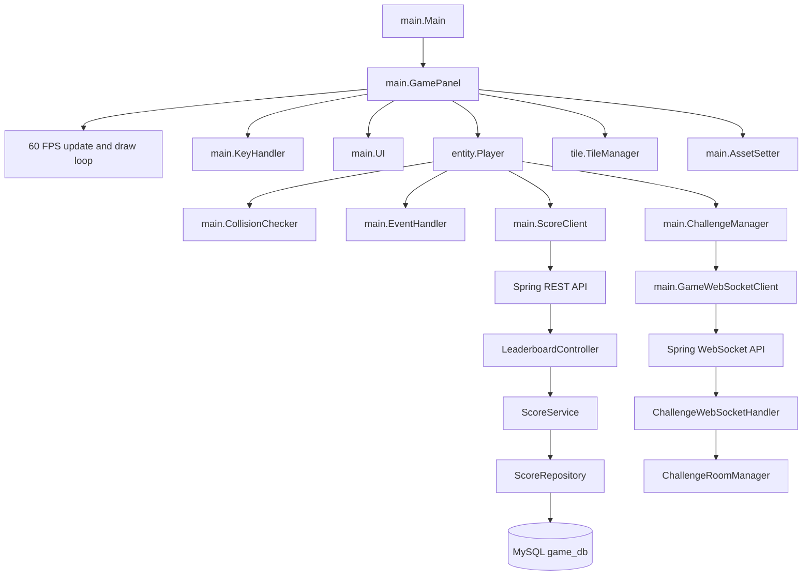

# Arena of Chaos

Arena of Chaos is a Java desktop action-adventure game built with Java Swing and
Java2D. The client contains a tile-based world, real-time movement and combat,
inventory and trading screens, local save/configuration support, score
submission, and an optional two-player challenge mode backed by a Spring Boot
service.

The repository contains two related applications:

- **Desktop game client**: the Java source under [`src/`](./src), packaged
  resources under [`src/res/`](./src/res), and compiled classes under
  [`bin/`](./bin).
- **Optional backend**: the Spring Boot application under
  [`game-backend/`](./game-backend). It provides the leaderboard HTTP API and
  the WebSocket protocol used by Challenge Mode.

## Project Overview

The game starts in a fixed-size Swing window titled **ARENA OF CHAOS**. The
client runs a 60 FPS update/draw loop, renders a 20×12 viewport over a 50×50
tile map, and keeps gameplay entities in per-map arrays. The player explores
the world, defeats monsters, collects items, gains experience, improves
statistics, and can move between the exterior and an interior map.

Single Player can be played without the backend for gameplay, local save/load,
and scoring. The client attempts to use the backend when it submits a score or
retrieves the high score; those requests fail gracefully when the backend is
unavailable. Challenge Mode requires the backend because room creation, joining,
live rankings, and result calculation are implemented through WebSockets.

## Game Description and Objectives

The implemented gameplay loop is:

1. Start a new single-player game and enter a player name.
2. Explore the map and navigate around collidable terrain.
3. Attack Green Slimes and the later Zombie wave.
4. Collect coins, hearts, mana crystals, and equipment.
5. Earn experience and level up while increasing the score.
6. Use the healing pool, merchant, inventory, and map transition where needed.
7. Continue until the player dies or the run is saved and resumed later.

In Challenge Mode, two players join the same server room and compete for the
highest score during a host-selected duration. The server ranks players by
score and announces a winner or tie.

## Implemented Features

- Java Swing/Java2D desktop game window.
- 60 FPS game loop.
- Tile-based rendering with collision-aware terrain.
- Two loaded maps:
  - `worldV3.txt` as map `0`, the main exterior world.
  - `interior01.txt` as map `1`, the interior/merchant area.
- Player name entry with a default of `Player1`.
- Single-player title menu with new game, Challenge Mode, load game, and quit.
- Player movement in four directions.
- Sword attacks and a fireball projectile.
- Green Slime and Zombie enemies with movement, contact damage, path-finding
  support, dying animations, drops, experience, and score values.
- A Zombie wave after all currently active Green Slimes are defeated.
- Continuous enemy spawning on the exterior map after the initial wave.
- Health and mana display, score/high-score display, and challenge timer.
- Inventory, character statistics, item selection, consumables, weapons, and
  shields.
- Merchant dialogue and trading screen.
- Collectible coins, keys, hearts, mana crystals, and equipment.
- Destructible interactive dry trees that can become trunks.
- Healing pool, damage pit, dialogue, teleport, pause, transition, and game
  over states.
- WAV music and sound effects with configurable volume levels.
- Local save data in `save_game.dat`.
- Local audio/full-screen configuration in `config.txt`.
- HTTP score save and high-score retrieval through the optional backend.
- Optional two-player Challenge Mode over
  `ws://<host>:8080/ws/challenge`.
- In-memory challenge rooms with six-digit room codes, a two-player limit,
  live score/life/kills updates, and final ranking.

### Partially implemented or optional functionality

- Challenge Mode is implemented in both client and backend, but it is not
  usable unless the backend and its MySQL database are available.
- Score submission and high-score retrieval are backend calls. The game still
  starts when the backend is offline, but high-score retrieval returns `0` and
  score requests cannot be stored.
- The desktop client has no Maven or Gradle build file. The repository includes
  compiled client classes and [`run-game.bat`](./run-game.bat), but rebuilding
  the client must be done with `javac` or an IDE configuration.
- Challenge rooms are held in backend memory. They are removed when all
  connected sessions have disconnected and are not persisted in MySQL.

## Technologies and Tools

### Desktop client

- Java SE AWT/Swing (`JFrame`, `JPanel`, `Graphics2D`, keyboard listeners).
- Java 11+ APIs, including `java.net.http.HttpClient` and
  `java.net.http.WebSocket`.
- Java Sound API for WAV playback.
- Plain-text map, configuration, and save files.
- PNG, WAV, and TrueType font resources.

### Backend

- Java 17, as configured in [`game-backend/pom.xml`](./game-backend/pom.xml).
- Spring Boot 3.1.6.
- Spring Web for REST endpoints.
- Spring Data JPA.
- Spring WebSocket.
- MySQL Connector/J 8.0.33.
- Jackson, supplied by the Spring Boot dependencies, for WebSocket message
  handling.
- Maven.

## Architecture

### Desktop architecture

`main.Main` creates the Swing window and a `main.GamePanel`. `GamePanel`
initializes resources and entities, starts the game thread, and coordinates
updates and rendering. `KeyHandler` converts keyboard input into either
movement flags or state-specific menu actions. `Player` performs movement,
collision checks, attacks, item interactions, progression, and game-over
transitions.

`TileManager` loads tile images and map text files. `AssetSetter` places
objects, NPCs, monsters, and interactive tiles. `CollisionChecker` checks
terrain, objects, entities, and player contact. `EventHandler` handles
location-based events such as map transitions, the healing pool, and the pit.
`UI` renders menus, HUD information, dialogue, inventory, and challenge
screens.

The update loop runs only gameplay entity updates in `playState`; menu and
dialogue states are rendered through state-specific UI methods. During
rendering, entities are sorted by world Y coordinate before drawing so that
objects closer to the bottom of the map appear in front.

### Backend architecture

The backend has two communication surfaces:

- `LeaderboardController` exposes REST endpoints backed by `ScoreService` and
  `ScoreRepository`.
- `ChallengeWebSocketHandler` handles challenge-room messages. It uses
  `ChallengeRoomManager` for in-memory rooms and tracks WebSocket sessions by
  room code.

The client uses `main.ScoreClient` for HTTP score operations and
`main.GameWebSocketClient` plus `main.ChallengeManager` for Challenge Mode.



### Main execution flow

1. `main.Main.main` creates and configures the `JFrame`.
2. `GamePanel` is added to the window and loads `config.txt`.
3. `setupGame()` places assets, sets the title state, and prepares the
   off-screen render image.
4. `startGameThread()` starts the update/draw loop.
5. The title menu changes `gameState` based on keyboard input.
6. Starting a game calls `Player` initialization, starts music, and enters
   `playState`.
7. `GamePanel.update()` updates the player, NPCs, monsters, projectiles,
   particles, and interactive tiles.
8. Rendering draws the current map, sorted entities, and state-specific UI.
9. Window closing saves an active single-player game when the player is alive
   and not already at a title, name-entry, or game-over screen.

## Directory Structure

```text
ArenaOfChaos/
├── src/
│   ├── ai/                 Path-finding and score client helpers
│   ├── entity/             Player, NPC, projectile, particle, base entity
│   ├── main/               Startup, game loop, input, UI, state, save/config
│   ├── monster/            Green Slime and Zombie implementations
│   ├── object/             Weapons, shields, consumables, pickups, projectiles
│   ├── tile/               Tile definitions and map loading/rendering
│   ├── tile_interactive/   Destructible/environment-interaction tiles
│   └── res/                Maps, sprites, sounds, and fonts
├── bin/                    Compiled client classes and runtime resources
├── game-backend/
│   ├── pom.xml             Spring Boot/Maven build definition
│   └── src/main/
│       ├── java/...        REST, WebSocket, room, score, and model classes
│       └── resources/      application.properties
├── config.txt              Full-screen and audio volume settings
├── websocket_config.txt    WebSocket host override; defaults to localhost
├── run-game.bat            Windows launcher for compiled client classes
├── save_game.dat           Local single-player save slot, when present
└── .idea/                  IntelliJ IDEA project metadata
```

The `bin/` directory and `game-backend/target/` contain generated/compiled
output. They are useful for the included launcher or an already-built backend,
but the source of truth is under `src/` and `game-backend/src/`.

## Important Packages and Classes

### Client packages

| Package/class | Responsibility |
|---|---|
| [`main.Main`](./src/main/Main.java) | Creates the window, loads configuration, sets up the game, and starts the loop. |
| [`main.GamePanel`](./src/main/GamePanel.java) | Central game context, state machine, entity collections, update loop, and renderer. |
| [`main.KeyHandler`](./src/main/KeyHandler.java) | Maps keyboard input to movement, combat, menus, inventory, and challenge actions. |
| [`main.UI`](./src/main/UI.java) | Draws the title screens, HUD, dialogue, inventory, options, trade, and challenge screens. |
| [`entity.Entity`](./src/entity/Entity.java) | Shared entity behavior including movement, collision support, animation, drops, and path-finding hooks. |
| [`entity.Player`](./src/entity/Player.java) | Player stats, movement, attacks, projectiles, inventory use, leveling, score, and death handling. |
| [`main.AssetSetter`](./src/main/AssetSetter.java) | Places map objects, NPCs, monsters, interactive trees, Zombie waves, and continuous enemies. |
| [`tile.TileManager`](./src/tile/TileManager.java) | Loads tile images and 50×50 map layouts, then draws the visible world. |
| [`main.CollisionChecker`](./src/main/CollisionChecker.java) | Checks tile, object, entity, and player collisions. |
| [`main.EventHandler`](./src/main/EventHandler.java) | Handles pits, healing, teleportation, and NPC interaction locations. |
| [`main.SaveLoad`](./src/main/SaveLoad.java) | Reads and writes the local single-player save slot. |
| [`main.Config`](./src/main/Config.java) | Reads and writes full-screen and audio volume settings. |
| [`main.Sound`](./src/main/Sound.java) | Loads and plays music and WAV sound effects. |
| [`main.ChallengeManager`](./src/main/ChallengeManager.java) | Maintains client-side challenge state and interprets server messages. |
| [`main.GameWebSocketClient`](./src/main/GameWebSocketClient.java) | Opens the Java WebSocket connection and sends/receives text messages. |
| [`main.ScoreClient`](./src/main/ScoreClient.java) | Sends game-over scores and retrieves the high score over HTTP. |
| [`ai.PathFinder`](./src/ai/PathFinder.java) | Searches walkable map nodes for entity path-finding. |
| [`monster.MON_GreenSlime`](./src/monster/MON_GreenSlime.java) | Green Slime behavior, projectile attacks, drops, experience, and score. |
| [`monster.MON_Zombie`](./src/monster/MON_Zombie.java) | Zombie behavior, chasing, contact damage, drops, experience, and score. |
| `object.*` | Concrete weapons, shields, pickups, consumables, doors, chests, and projectiles. |

### Backend packages

| Package/class | Responsibility |
|---|---|
| [`GameBackendApplication`](./game-backend/src/main/java/com/example/gamebackend/GameBackendApplication.java) | Spring Boot entry point. |
| [`LeaderboardController`](./game-backend/src/main/java/com/example/gamebackend/controller/LeaderboardController.java) | REST leaderboard and score endpoints. |
| [`ScoreService`](./game-backend/src/main/java/com/example/gamebackend/service/ScoreService.java) | Saves scores and retrieves the top ten/highest score. |
| [`ScoreRepository`](./game-backend/src/main/java/com/example/gamebackend/repository/ScoreRepository.java) | Spring Data JPA repository for `Score`. |
| [`Score`](./game-backend/src/main/java/com/example/gamebackend/model/Score.java) | JPA entity stored in the `scores` table. |
| [`WebSocketConfig`](./game-backend/src/main/java/com/example/gamebackend/config/WebSocketConfig.java) | Registers `/ws/challenge` and enables WebSockets. |
| [`ChallengeWebSocketHandler`](./game-backend/src/main/java/com/example/gamebackend/handler/ChallengeWebSocketHandler.java) | Processes room creation/join/start/update/end messages and broadcasts rankings/results. |
| [`ChallengeRoomManager`](./game-backend/src/main/java/com/example/gamebackend/service/ChallengeRoomManager.java) | Creates, finds, joins, and removes in-memory two-player rooms. |
| `ChallengeRoom` / `ChallengePlayer` | In-memory room status and per-player score/life/kills models. |

## Game Mechanics

### Player

The default player starts on map `0` at tile coordinates `(23, 21)` with:

- Level 1.
- 6 life and 4 mana.
- Strength 1 and dexterity 1.
- 800 coins.
- Normal Sword, Wood Shield, and Fireball.
- A Key in the initial inventory.
- 0 experience and 5 experience required for the next level.

Leveling up increases maximum life and restores life/mana through the existing
`Player.checkLevelUp()` behavior. Attack is derived from strength and the
equipped weapon; defense is derived from dexterity and the equipped shield.

### Combat and enemies

- **Normal Sword** is the default melee weapon and supports knockback.
- **Fireball** is a mana-consuming projectile.
- **Green Slime** has 4 life, attack 2, defense 0, awards 2 experience and
  10 score, and can launch a Rock projectile.
- **Zombie** has 10 life, attack 4, defense 1, awards 6 experience and 30
  score, and chases within its configured range.
- Contact damage uses the enemy attack reduced by player defense, with a
  minimum of one damage.
- Defeated monsters can drop Bronze Coins, Hearts, and Mana Crystals.

The initial Green Slimes are placed when the game is initialized. Once all
active Green Slimes on the current map are defeated, five Zombie spawn
attempts are made at valid distant walkable tiles. On map `0`, additional
enemies can spawn every 240 frames (approximately four seconds at 60 FPS)
while gameplay is active.

### Scoring and progression

The player score increases when a monster is killed. The client also tracks
enemy kills and experience. Single-player game-over submits the score to
`POST /api/score/save`; the high score is requested when a player name is
confirmed. Challenge Mode sends score, life, and kill counts to the backend
once per second.

### Maps and interactions

Map `0` contains the main exploration area, initial monsters, equipment,
healing/pit events, and the exterior enemy spawning system. Entering the
configured transition location moves to map `1`, where the merchant is placed.
The reverse transition returns to map `0`.

The merchant offers a trade UI with Red Potion, Key, Normal Sword, Woodcutter's
Axe, Wood Shield, and Blue Shield. The item classes define their prices and
types. Interactive dry trees require the appropriate item and turn into trunks
when destroyed.

## Player Controls

| Key | Gameplay action |
|---|---|
| `W` | Move up; navigate menus upward. |
| `A` | Move left; adjust option/trade values where applicable. |
| `S` | Move down; navigate menus downward. |
| `D` | Move right; adjust option/trade values where applicable. |
| `Enter` | Attack/interact; confirm menu choices; use selected inventory/trade item. |
| `F` | Fire the Fireball projectile when enough mana and the shot cooldown allow it. |
| `P` | Pause or resume gameplay. |
| `C` | Open or close the character/inventory screen. |
| `Escape` | Open options during gameplay or return from several sub-screens. |
| `R` | Reload the current map resource for the current map (`worldV3.txt` or `interior01.txt`). |
| `Backspace` | Delete the last character during name/challenge input. |

Menu navigation uses `W`/`S` and confirmation uses `Enter`. The title screen
also provides `LOAD GAME`, which only succeeds when the local save slot is
marked available.

## Game States and Navigation

`GamePanel` defines the following states:

- `titleState` — main menu.
- `nameInputState` — single-player name entry.
- `playState` — active gameplay.
- `pauseState` — paused gameplay.
- `dialogueState` — NPC/event dialogue.
- `characterState` — player statistics and inventory.
- `optionState` — options and volume controls.
- `tradeState` — merchant trading.
- `transitionState` — map transition.
- `gameOverState` — single-player death screen.
- `challengeLobbyState` — host, join, or leave challenge lobby.
- `challengeInputState` — host/join names, duration, and room code input.
- `challengeWaitingState` — wait for the other player and host start.
- `challengeDeadState` — challenge player death screen.
- `challengeEndWaitingState` — waiting for final server result.
- `challengeResultState` — winner and final ranking.

## Backend API and Challenge Protocol

### REST endpoints

The Spring controller is rooted at `/api`:

| Method | Path | Purpose |
|---|---|---|
| `GET` | `/api/leaderboard` | Returns the top ten scores ordered descending. |
| `GET` | `/api/score/highest` | Returns `{ "highScore": number }`. |
| `POST` | `/api/score` | Saves a score entity. |
| `POST` | `/api/score/save` | Saves a score entity; this is the endpoint used by the client. |

The `Score` model accepts `maxScore` as an input alias for its `score` field.
Scores are stored in the JPA `scores` table with player name, score, generated
ID, and creation time.

### WebSocket endpoint

The backend registers:

```text
ws://localhost:8080/ws/challenge
```

The client reads the host from [`websocket_config.txt`](./websocket_config.txt);
the default is `localhost`. The message types implemented by the handler are:

- `CREATE_ROOM`
- `JOIN_ROOM`
- `START_ROOM`
- `PLAYER_UPDATE`
- `END_CHALLENGE`

The server broadcasts `ROOM_CREATED`, `PLAYER_JOINED`, `START_CHALLENGE`,
`LIVE_RANKING`, `CHALLENGE_RESULT`, and `ERROR` messages. A room must contain
exactly two players before the host can start it. The final winner is the
player with the higher score; equal scores produce `TIE`.

## Prerequisites

### To run the precompiled desktop game

- Windows, because the included launcher is a `.bat` file.
- A Java runtime compatible with the compiled classes.
- The repository checkout with `bin/` and its `bin/res/` resources intact.

### To rebuild the desktop game

- A JDK with `javac` available on `PATH`.
- A terminal opened at the repository root.

### To run the backend

- JDK 17 or a compatible newer JDK.
- Maven.
- MySQL Server.
- A MySQL database named `game_db`, with connection settings matching the
  backend's local configuration.

## Installation and Setup

Clone or download the repository and open a terminal at its root:

```powershell
cd "C:\path\to\ArenaOfChaos"
```

Keep the `bin/res` resources beside the compiled client classes. The client
loads resources from the classpath using paths such as `/res/player/...` and
`/res/maps/...`.

For backend-backed features, configure the local database connection in
[`game-backend/src/main/resources/application.properties`](./game-backend/src/main/resources/application.properties)
or through the normal Spring Boot configuration mechanism. Do not commit local
database credentials.

## How to Run the Game

### Windows launcher

The repository provides the exact launcher used for the compiled client:

```bat
run-game.bat
```

The script changes to the project directory and runs:

```bat
javaw -cp "%cd%\bin" main.Main
```

The launcher uses the already compiled classes in `bin`. It does not start the
backend.

### From VS Code

1. Open the repository root in VS Code.
2. Ensure a JDK is installed and available to the Java extension.
3. Run [`run-game.bat`](./run-game.bat) from the integrated terminal, or open
   the file in Explorer and execute it through the Windows shell.
4. If launching `main.Main` through a Java runner/debug configuration, use
   `bin` as the classpath/output root and keep the working directory at the
   repository root so `config.txt`, `save_game.dat`, and
   `websocket_config.txt` resolve correctly.

There is no committed VS Code task or desktop Maven/Gradle configuration in
the repository, so the batch file is the most direct supported launcher.

### Rebuild the desktop classes from PowerShell

The client has no desktop build descriptor. With a JDK installed, compile all
client sources into the existing `bin` output directory:

```powershell
javac -encoding UTF-8 -d bin (Get-ChildItem -Recurse -Filter *.java src | ForEach-Object { $_.FullName })
```

Then run:

```bat
run-game.bat
```

The command above assumes the existing `bin/res` resource tree is present. It
does not copy resources; the resource files must remain available on the
runtime classpath.

## How to Run the Backend

1. Start MySQL and create the `game_db` database.
2. Set the local datasource URL, username, and password in
   [`application.properties`](./game-backend/src/main/resources/application.properties).
3. From the backend directory, run:

```powershell
cd "C:\path\to\ArenaOfChaos\game-backend"
mvn spring-boot:run
```

The service listens on port `8080`. Build a packaged backend with:

```powershell
mvn clean package
```

Then run the generated Spring Boot jar from `game-backend\target` with:

```powershell
java -jar target\game-backend-0.0.1-SNAPSHOT.jar
```

The backend uses `spring.jpa.hibernate.ddl-auto=update`, so JPA may create or
update the `scores` table when the application connects successfully.

## Configuration and Data Files

| File | Purpose |
|---|---|
| [`config.txt`](./config.txt) | Three lines: full-screen mode (`On`/`Off`), music volume scale, and sound-effect volume scale. The volume scale is 0–5. |
| [`websocket_config.txt`](./websocket_config.txt) | One-line WebSocket host name or address. The client defaults to `localhost` if the file is absent or empty. |
| [`save_game.dat`](./save_game.dat) | Plain-text single-player save slot containing map, position, direction, life/mana, score, coins, and an availability flag. |
| [`application.properties`](./game-backend/src/main/resources/application.properties) | Backend port and MySQL/JPA settings. |

The source does not define environment-variable names for these settings.
Spring Boot can still be configured through its standard external
configuration mechanisms, but the committed application properties are the
settings directly referenced by this project.

## Troubleshooting

### The game window does not start

- Confirm that Java is installed and `java` is available on `PATH`.
- Run `run-game.bat` from the repository root so `%cd%\bin` resolves correctly.
- Confirm that `bin\main\Main.class` and the `bin\res` directory exist.
- If classes were rebuilt, confirm that compilation completed without errors.

### Images, fonts, or sounds are missing

- Do not remove or relocate `bin\res`.
- Start the launcher from the repository root.
- When using an IDE, include `bin` or the resource directory on the runtime
  classpath and use the repository root as the working directory.

### Load Game says no save is available

- A save is only written for an active, living single-player game when the
  window closes.
- Starting a new named game invalidates the previous save slot.
- A save marked unavailable cannot be loaded.

### Scores are not saved or the high score is zero

- Start the backend on port `8080`.
- Verify that MySQL is running and `game_db` is reachable.
- Check the backend datasource settings.
- The game can still be played offline, but score HTTP requests require the
  backend.

### Challenge Mode cannot connect

- Start the backend first.
- Confirm that `websocket_config.txt` contains the correct backend host.
- Confirm that port `8080` is reachable and `/ws/challenge` is not blocked.
- A host must wait for exactly one other player before starting the room.

### Maven cannot start the backend

- Confirm that Maven and JDK 17+ are installed.
- Run Maven from `game-backend`, where `pom.xml` is located.
- Check the MySQL URL, username, password, and database availability.

## Known Limitations

- The desktop client has no dedicated Maven/Gradle build configuration or
  automated test suite in the repository.
- The included launcher targets Windows and the repository does not include a
  cross-platform launch script.
- The client uses fixed world, array, viewport, and entity capacities in code.
- Challenge rooms and live player data are in memory and disappear when the
  backend process stops or all room sessions disconnect.
- Challenge WebSocket registration allows all origins (`*`), which is suitable
  for the current prototype but should be reviewed before production use.
- Backend configuration currently expects a MySQL connection and does not
  provide a bundled database or migration files.
- The client and backend communicate with fixed local HTTP/WebSocket port
  conventions rather than a centralized typed configuration.
- Save data is a simple local text format and is not versioned or encrypted.
- The game uses hand-written lightweight JSON parsing in the client challenge
  manager rather than a shared protocol model.

## Future Improvements

The following are potential improvements suggested by the current structure,
not claims about existing functionality:

- Add a desktop build tool configuration and a repeatable resource-copy step.
- Add automated unit, integration, and gameplay smoke tests.
- Externalize client REST/WebSocket URLs and backend settings consistently.
- Add database migrations, validation, authentication, and production-safe
  WebSocket origin rules.
- Persist challenge rooms or introduce a coordinated multiplayer service if
  challenges need to survive backend restarts.
- Replace manual client JSON parsing with a shared, validated message model.
- Add configurable key bindings, more save slots, and save-format versioning.
- Expand the map, enemy roster, class differences, quests, and progression.
- Add packaging for non-Windows platforms and a distributable game build.

## Credits and Acknowledgments

This repository contains the Arena of Chaos game client, its game resources,
and the accompanying Spring Boot backend. The implementation uses standard
Java, Spring Boot, Maven, Java Sound, and MySQL technologies. Asset and audio
files are included in the repository under [`src/res/`](./src/res); their
individual licensing information is not specified in the source tree, so
verify asset rights before publishing a public distribution.
